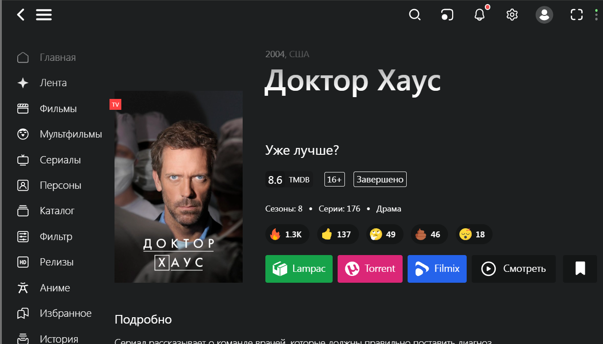
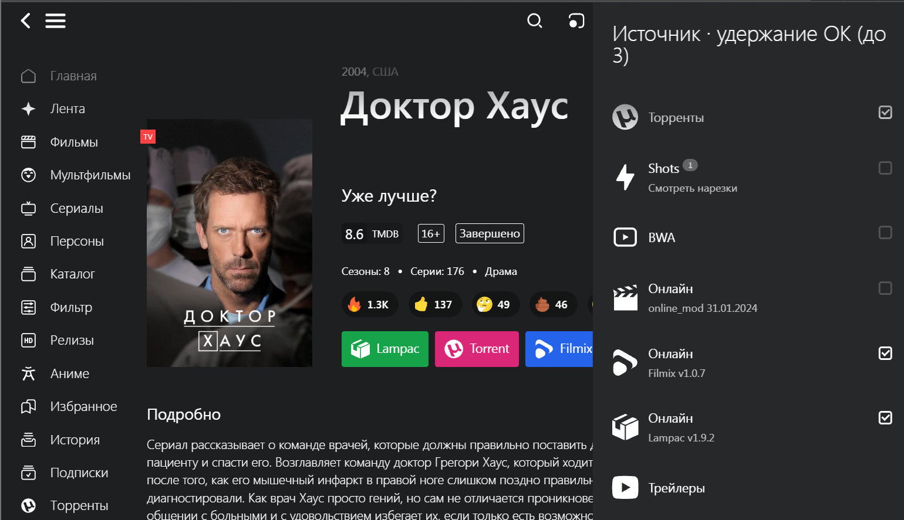
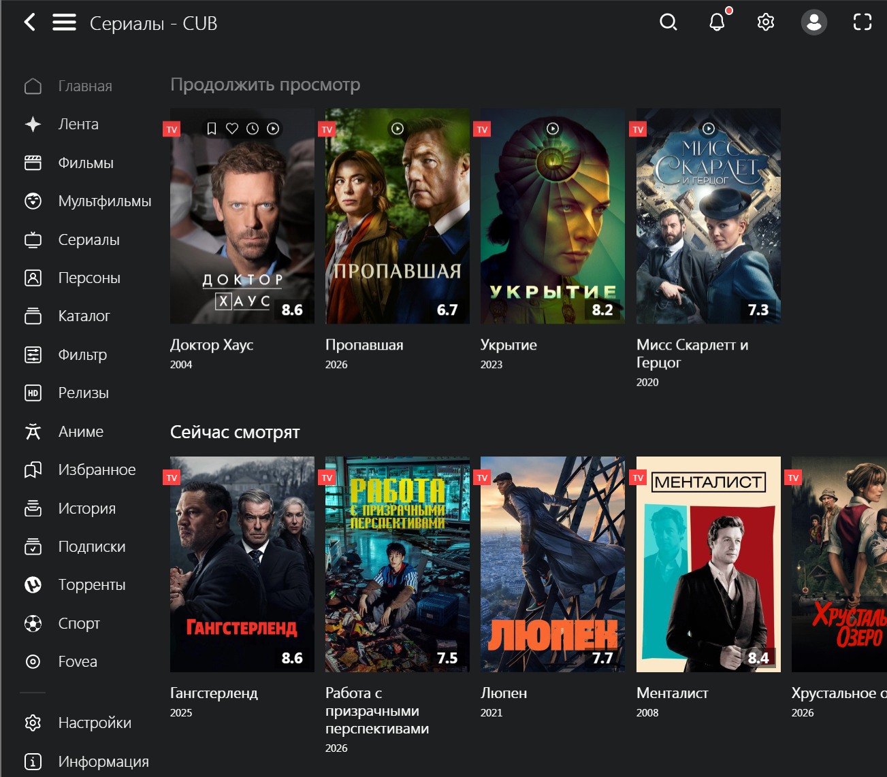

# Lampa / Lampac plugins

Плагины для Lampa и Lampac:

- `fpb.js` — быстрые кнопки источников на карточке фильма/сериала.
- `history-first.js` — «Продолжить просмотр» первой строкой в разделе «Сериалы».

Версии: `fpb.js` — 2.0.0, `history-first.js` — 1.2.0.



## Что делают плагины

### fpb.js — быстрые кнопки источников

- Добавляет на карточку цветные кнопки выбранных источников.
- По умолчанию: Filmix (синий), Lampac (зелёный), Torrent (розовый).
- Если источника нет на карточке, его кнопка скрывается.
- Максимум 3 источника.
- Выбор источника: «Смотреть» → удерживайте OK на нужном источнике, чтобы поставить или снять чекбокс.
- Обычное нажатие Enter по-прежнему запускает источник.
- Выбор сохраняется в `Lampa.Storage` и применяется на всех карточках.
- Кнопки — ярлыки: нажатие запускает тот же источник, что и выбор в панели.
- Скрывает «Реакции», «Подписаться», «Опции»; «Смотреть» остаётся, «Избранное» — только иконка.
- Долгое нажатие OK в панели источников теперь выбирает быстрые кнопки, а не priority-кнопку.



### history-first.js — «Продолжить просмотр» наверх

- Переносит строку «Продолжить просмотр» в начало страницы категории.
- Данные не меняются, только порядок строк.
- Работает через `Lampa.Api.category` и `ContentRows`.



## Установка

### 1. В Lampa вручную

1. Откройте Lampa → **Расширения**.
2. Добавьте плагин по URL:
   - `https://weber.github.io/lampa-plugins/fpb.js`
   - `https://weber.github.io/lampa-plugins/history-first.js`
3. Полностью перезапустите Lampa.

Если GitHub Pages ещё не включён, используйте raw-ссылки:

- `https://raw.githubusercontent.com/weber/lampa-plugins/master/fpb.js`
- `https://raw.githubusercontent.com/weber/lampa-plugins/master/history-first.js`

### 2. Через Lampac (для всех клиентов)

Добавьте в `init.conf`:

```json
"LampaWeb": {
  "customPlugins": [
    {
      "url": "https://weber.github.io/lampa-plugins/fpb.js",
      "status": 1,
      "name": "FPB — быстрые кнопки",
      "author": "weber"
    },
    {
      "url": "https://weber.github.io/lampa-plugins/history-first.js",
      "status": 1,
      "name": "History First",
      "author": "weber"
    }
  ]
}
```

Перезапустите Lampac.

Если секция `LampaWeb` уже есть, добавьте объекты в существующий массив `customPlugins`.

### 3. Включить GitHub Pages

1. Репозиторий должен быть публичным.
2. GitHub → **Settings** → **Pages**.
3. Source: **Deploy from a branch**.
4. Branch: `master`, folder: `/ (root)`.
5. Сохранить и подождать 1–2 минуты.

После этого ссылки будут:

- `https://weber.github.io/lampa-plugins/fpb.js`
- `https://weber.github.io/lampa-plugins/history-first.js`

## Настройка быстрых кнопок

1. Откройте карточку фильма или сериала.
2. Нажмите «Смотреть».
3. Удерживайте OK на нужном источнике — чекбокс включится или выключится.
4. Выберите до 3 источников.
5. Закройте панель — кнопки на карточке обновятся сразу.

На ПК долгое нажатие можно сделать долгим кликом или правой кнопкой мыши.

По умолчанию выбраны `filmix`, `lampac`, `torrent`. Если какого-то источника нет, его кнопка не показывается. Выбор сохраняется между запусками Lampa.

## Совместимость

- Протестировано с Lampa 1.87.8 / Lampac NextGen.
- Плагины клиентские; серверные файлы Lampac менять не нужно.
- `fpb.js` зависит от разметки карточки и панели источников.
- Для кнопок Filmix/Lampac/Torrent должны быть установлены соответствующие источники. Другие источники можно выбрать в панели.
- В других версиях Lampa или плагинов источников может потребоваться правка.

## Диагностика

- URL плагина должен открываться в браузере и отдавать JavaScript, а не HTML.
- Приватный репозиторий не подойдёт.
- После обновления плагина полностью перезапустите Lampa.
- Если плагин не появился, проверьте список расширений и кэш.
- В `history-first.js` отладка выключена (`DEBUG = false`); при необходимости включите.
- Сбросить выбранные источники можно, очистив ключ `fpb_quick_sources` в настройках Lampa (localStorage).

## Удаление

- Lampa: удалите плагин в «Расширениях» и перезапустите.
- Lampac: удалите записи из `LampaWeb.customPlugins` и перезапустите.
- После удаления `history-first.js` вернёт стандартный порядок строк.

## Файлы

```text
fpb.js
history-first.js
images/
  Lampa_fpb-1.png
  Lampa_fpb-2.png
  Lampa_history_first.png
LICENSE
README.md
```

## Лицензия

GNU AGPLv3. См. [LICENSE](LICENSE).

## Обратная связь

Issues: https://github.com/weber/lampa-plugins/issues

Не официальный проект Lampa или Lampac. Используйте на свой риск.
